# Tugas Rutin 11 – E-Commerce DB + Secure Auth (Laravel)

Aplikasi e-commerce sederhana dengan database relasional, autentikasi Laravel Breeze, multi-role (admin / editor / user), custom middleware, dan otorisasi dengan Policy.

## Fitur
- 7 tabel e-commerce dengan foreign key: users, categories, products, orders, order_items, tags, product_tag
- Seeder + factory (54 produk realistis, 6 kategori, 5 tag, pesanan contoh)
- Model dengan relationships dan scope (`published`, `inStock`)
- Login, register, logout (Laravel Breeze)
- Multi-role dengan custom middleware `CheckRole` (`role:admin`)
- CRUD produk dengan eager loading dan validasi
- Otorisasi dengan `ProductPolicy`

## Cara menjalankan
1. `composer install`
2. Salin `.env.example` menjadi `.env`, lalu atur database (`DB_DATABASE=ecommerce_auth`, MySQL)
3. `php artisan key:generate`
4. Buat database `ecommerce_auth` di MySQL
5. `php artisan migrate:fresh --seed`
6. `npm install`
7. Terminal 1: `npm run dev`
8. Terminal 2: `php artisan serve`
9. Buka `http://127.0.0.1:8000`

## Akun testing (password: `password`)
| Role | Email |
|---|---|
| admin | admin@example.com |
| editor | editor@example.com |
| user | user@example.com |

## Aturan akses
- **admin**: akses `/admin`, bisa mengedit dan menghapus semua produk
- **editor**: bisa menambah produk, mengedit dan menghapus hanya produk miliknya
- **user**: hanya bisa melihat daftar produk

## Catatan
Tugas menyebut `PostPolicy`. Karena entitas utama aplikasi ini adalah produk, otorisasi edit/delete diimplementasikan sebagai `ProductPolicy` dengan logika yang sama.

## Dokumentasi
Screenshot ada di folder `docs/` (query Tinker, Breeze, tes role, dan tes policy).
### Query Tinker
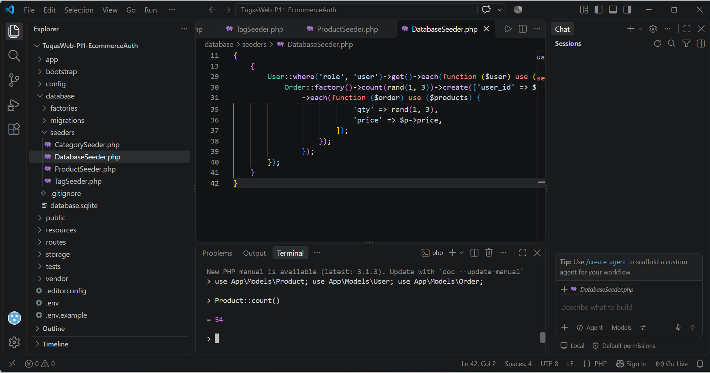
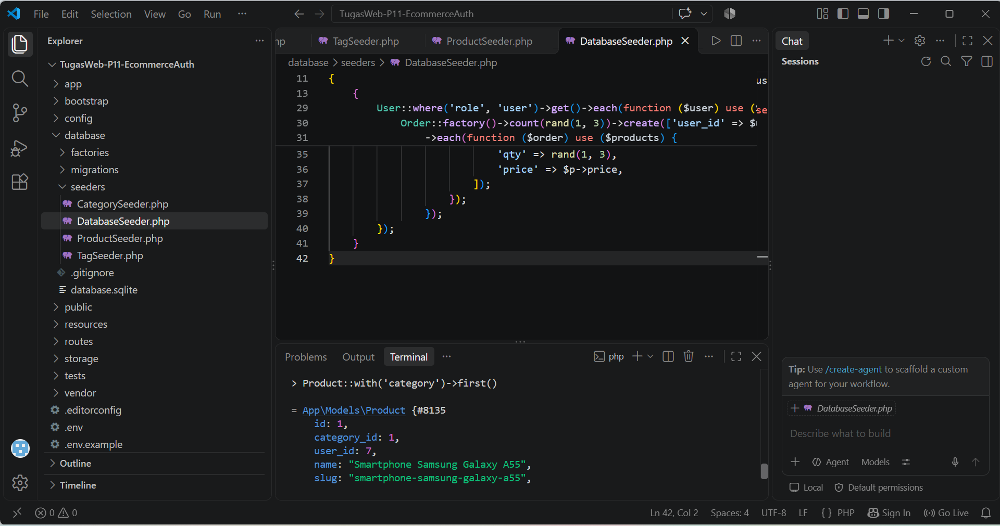
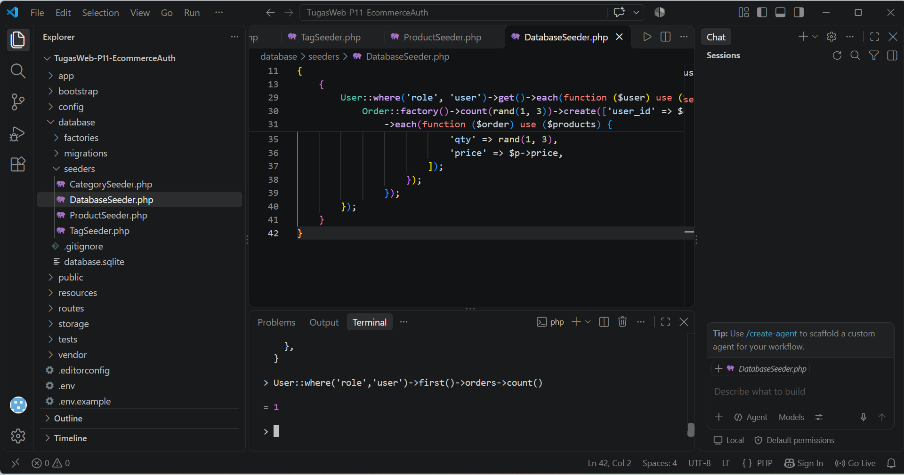
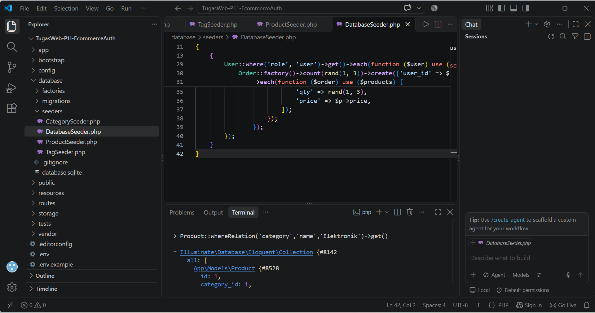
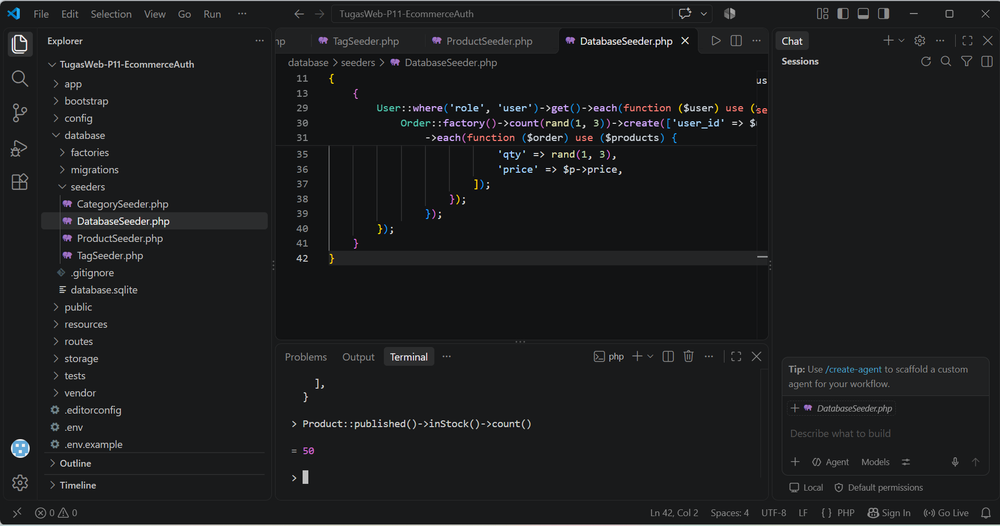

### Breeze (login, register, dashboard, logout)
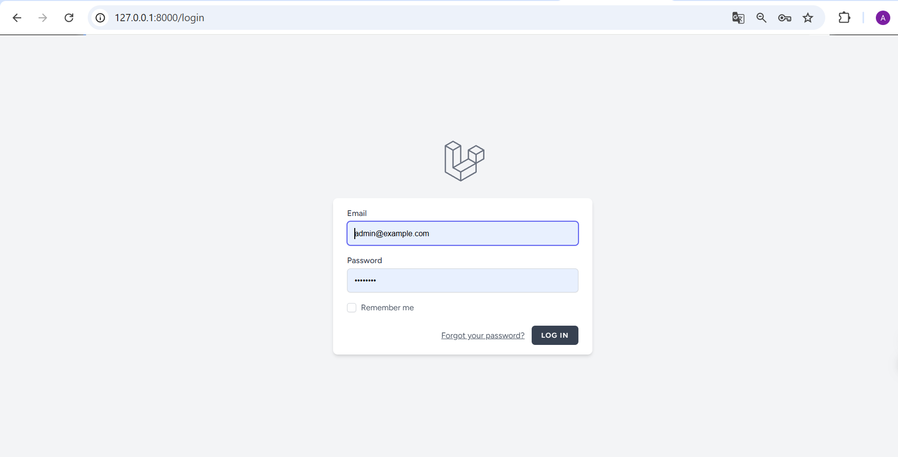
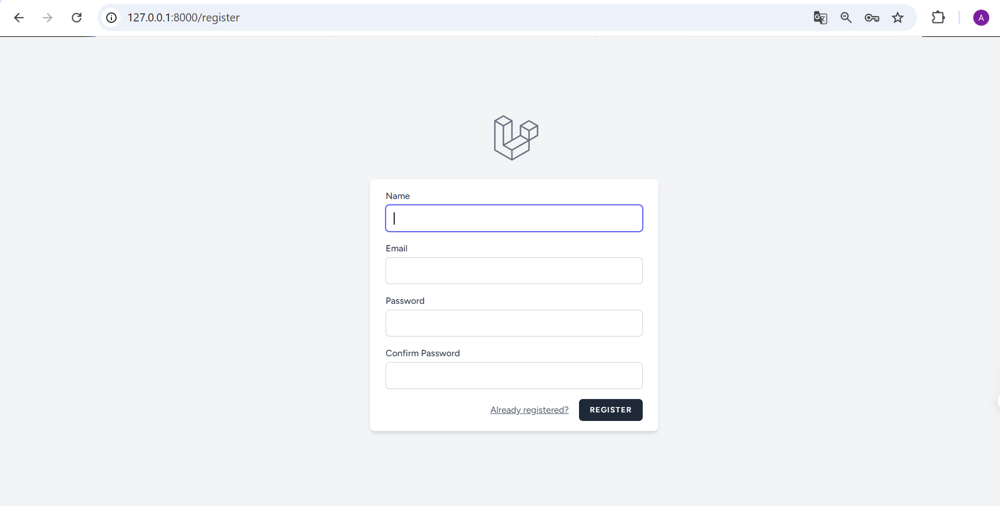
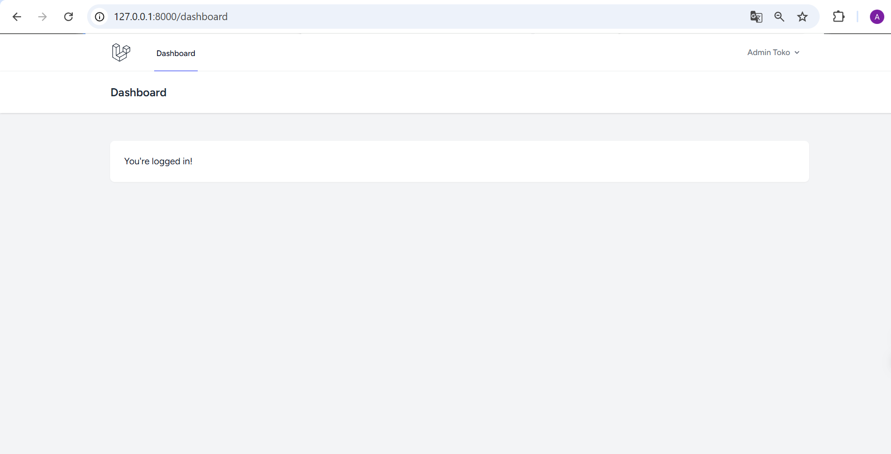
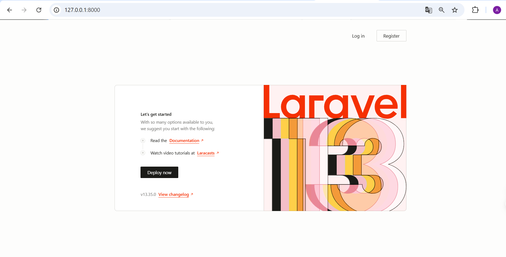

### Tes role dan middleware
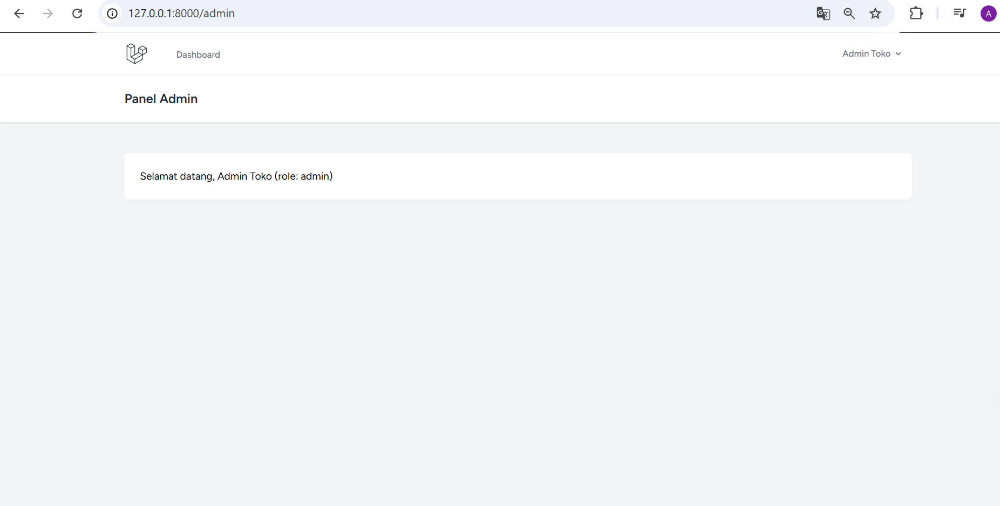
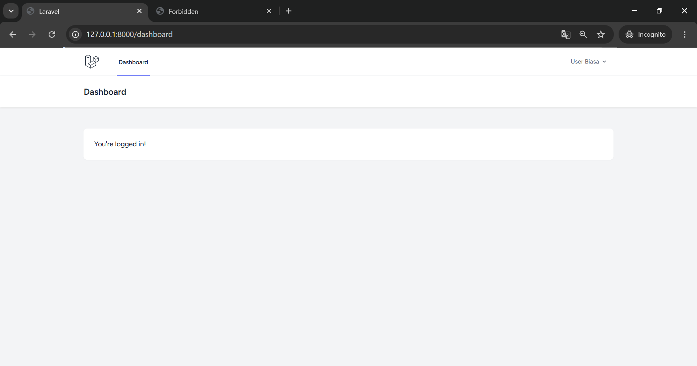
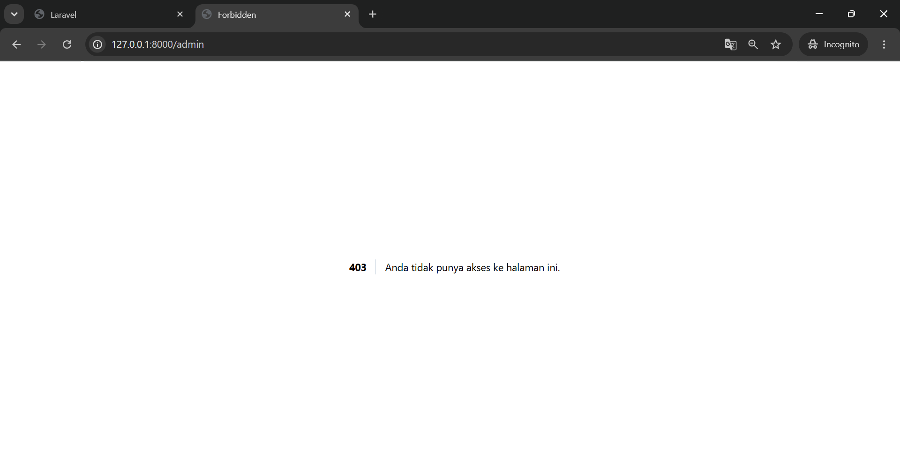

### Tes policy

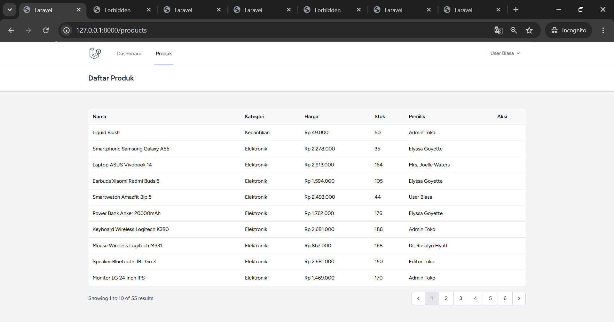
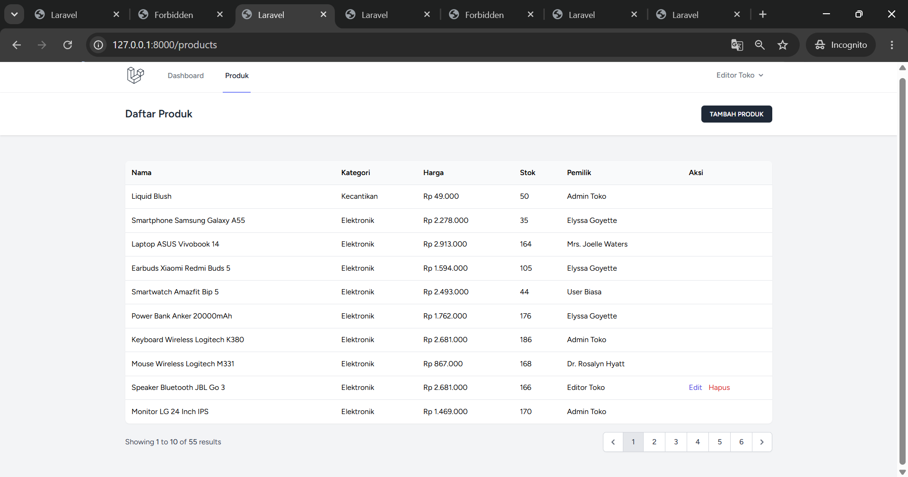
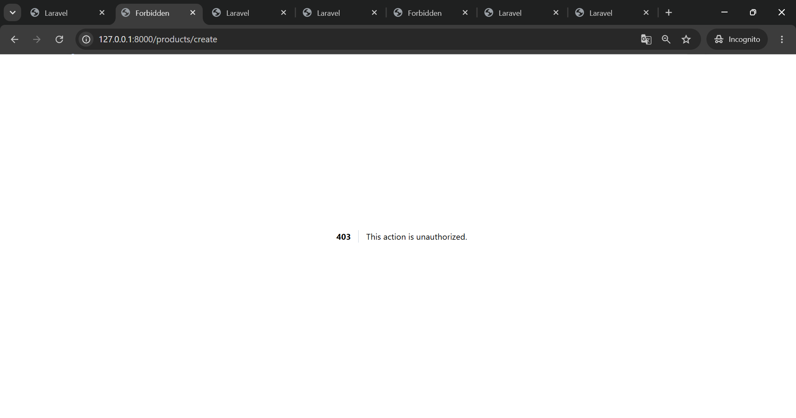
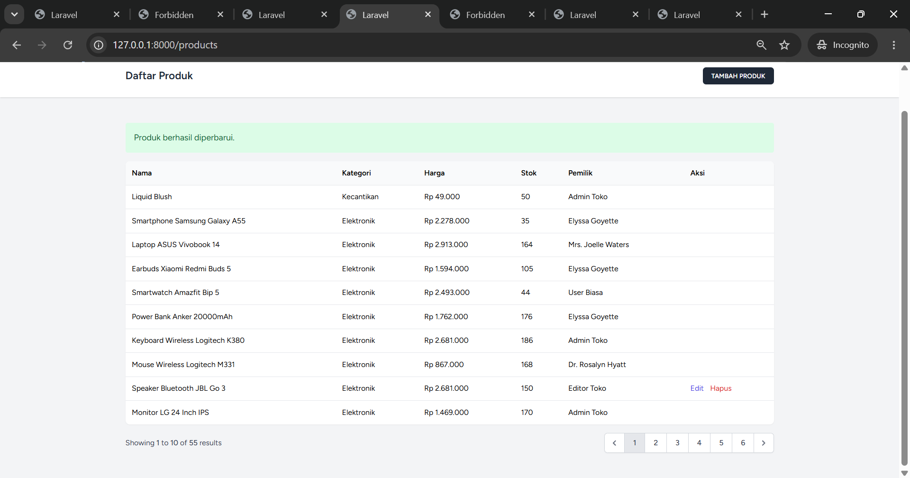
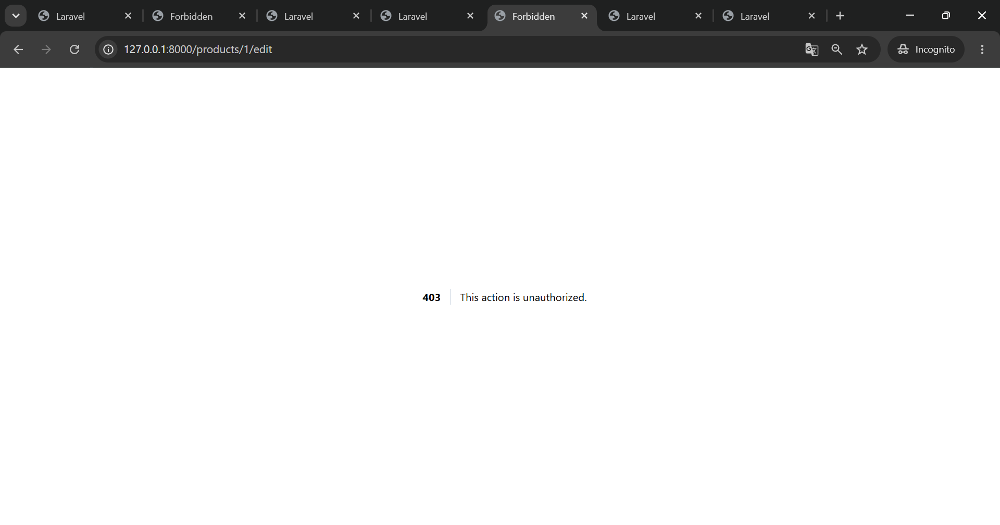
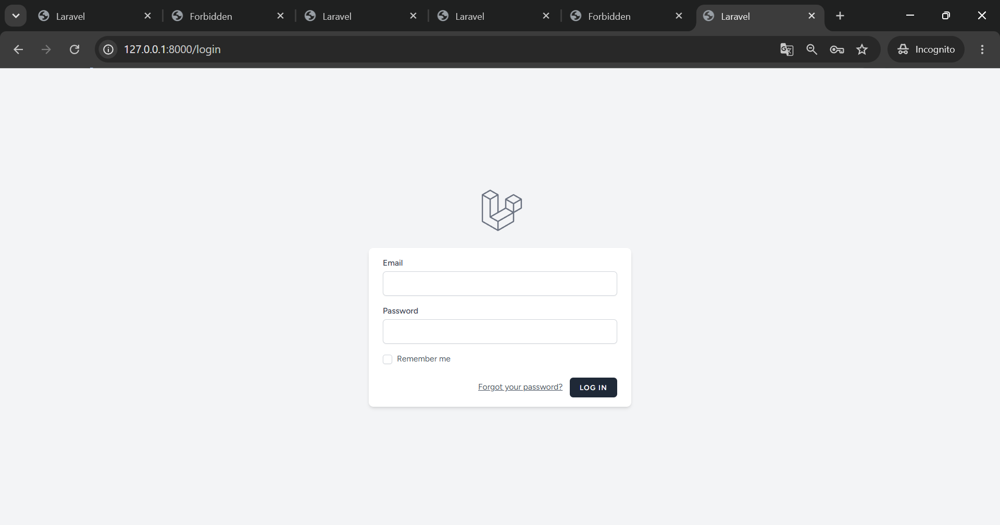